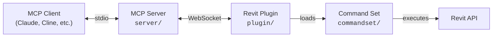

# revit-mcp

**Connect AI assistants to Autodesk Revit via the Model Context Protocol.**

revit-mcp enables AI clients like Claude, Cline, and other MCP-compatible tools to read, create, modify, and delete elements in Revit projects. It consists of three components: a TypeScript MCP server that exposes tools to AI, a C# Revit add-in that bridges commands into Revit, and a command set that implements the actual Revit API operations.

> [!NOTE]
> This is a fork of the original [revit-mcp](https://github.com/mcp-servers-for-revit/revit-mcp) project with additional tools and functionality improvements.

## Architecture



The **MCP Server** (TypeScript) translates tool calls from AI clients into WebSocket messages. The **Revit Plugin** (C#) runs inside Revit, listens for those messages, and dispatches them to the **Command Set** (C#), which executes the actual Revit API operations and returns results back up the chain.

## Requirements

- **Node.js 20+** (for the MCP server)
- **Autodesk Revit 2023 - 2027** (any supported version)

## Quick Start (Using a Release)

1. Download the ZIP for your Revit version from the [Releases](https://github.com/nhantruong96/revit-mcp/releases) page (e.g., `revit-mcp-v1.0.0-Revit2025.zip`)

2. Extract the ZIP and copy the contents to your Revit addins folder:
   ```
   %AppData%\Autodesk\Revit\Addins\<your Revit version>\
   ```
   After copying you should have:
   ```
   Addins/2025/
   ├── revit-mcp.addin
   └── revit_mcp_plugin/
       ├── RevitMCPPlugin.dll
       ├── ...
       └── Commands/
           └── RevitMCPCommandSet/
               ├── command.json
               └── 2025/
                   ├── RevitMCPCommandSet.dll
                   └── ...
   ```

3. Configure the MCP server in your AI client (see [MCP Server Setup](#mcp-server-setup))

4. Start Revit — if prompted about an unknown add-in, click **Always Load**

5. In Revit, click the **Settings** button on the revit-mcp ribbon tab, enable the commands you want to use, and click **Save**

6. Click the **Revit MCP Switch** button on the same ribbon panel to start the server — the button label flips to `MCP Server ON`. The server does not start automatically; without this step the AI client cannot reach Revit.

> **Note:** Enabled commands are loaded when the server starts. If you change which commands are enabled while the server is already running, click **Revit MCP Switch** twice (off, then on) to reload them — otherwise calls fail with `Method '<name>' not found`.

## MCP Server Setup

The MCP server is built from this repository. Requires **Node.js 20+**.

```bash
cd server
npm ci
npm run build
```

That produces `server/build/index.js`, which is the entry point your AI client runs.

**Claude Code**

Run this in a **terminal** (not inside Claude Code):

```bash
claude mcp add revit-mcp -- node C:\path\to\revit-mcp\server\build\index.js
```

**Claude Desktop**

Claude Desktop → Settings → Developer → Edit Config → `claude_desktop_config.json`:

```json
{
    "mcpServers": {
        "revit-mcp": {
            "command": "C:\\Program Files\\nodejs\\node.exe",
            "args": ["C:\\path\\to\\revit-mcp\\server\\build\\index.js"]
        }
    }
}
```

Restart Claude Desktop. When you see the hammer icon, the MCP server is connected.


Re-run `npm run build` after changing anything under `server/src/`.

> **Why not `npx`?** The npm package [`mcp-server-for-revit`](https://www.npmjs.com/package/mcp-server-for-revit) belongs to the upstream project and is still at `1.0.0`, so it has none of the tools or fixes in this fork. It also depends on `better-sqlite3` v11, which ships no prebuilt binary for Node 22+ and falls back to compiling from source with `node-gyp` — that needs Visual Studio with the "Desktop development with C++" workload, and without it the server exits before it can start. Building from source avoids both problems.

## Revit Plugin Setup

If using a release ZIP, the plugin is already included. For manual installation:

1. Build the plugin from `plugin/` (see [Development](#development))
2. Copy `revit-mcp.addin` to `%AppData%\Autodesk\Revit\Addins\<version>\`
3. Copy the `revit_mcp_plugin/` folder to the same addins directory

## Command Set Setup

If using a release ZIP, the command set is pre-installed inside the plugin. For manual installation:

1. Build the command set from `commandset/` (see [Development](#development))
2. Inside the plugin's installation directory, create `Commands/RevitMCPCommandSet/<year>/`
3. Copy the built DLLs into that folder
4. Copy `command.json` (from repo root) into `Commands/RevitMCPCommandSet/`

## Supported Tools

| Tool | Description |
| ---- | ----------- |
| `get_current_view_info` | Get current active view info |
| `get_current_view_elements` | Get elements from the current active view |
| `get_available_family_types` | Get available family types in current project |
| `get_selected_elements` | Get currently selected elements |
| `get_material_quantities` | Calculate material quantities and takeoffs |
| `ai_element_filter` | Intelligent element querying tool for AI assistants |
| `analyze_model_statistics` | Analyze model complexity with element counts |
| `create_point_based_element` | Create point-based elements (door, window, furniture) |
| `create_line_based_element` | Create line-based elements (wall, beam, pipe) |
| `create_surface_based_element` | Create surface-based elements (floor, ceiling, roof) |
| `create_grid` | Create a grid system with smart spacing generation |
| `create_level` | Create levels at specified elevations |
| `create_room` | Create and place rooms at specified locations |
| `create_dimensions` | Create dimension annotations in the current view |
| `create_structural_framing_system` | Create a structural beam framing system |
| `delete_element` | Delete elements by ID |
| `operate_element` | Operate on elements (select, setColor, hide, etc.) |
| `color_elements` | Color elements based on a parameter value |
| `tag_all_walls` | Tag all walls in the current view |
| `tag_all_rooms` | Tag all rooms in the current view |
| `export_room_data` | Export all room data from the project |
| `store_project_data` | Store project metadata in local database |
| `store_room_data` | Store room metadata in local database |
| `query_stored_data` | Query stored project and room data |
| `delete_stored_project` | Delete a stored project and its rooms from the local database (requires `confirm: true`) |
| `send_code_to_revit` | Send C# code to Revit to execute |
| `say_hello` | Connection test — returns Revit version, active document and view; shows nothing in Revit |

### Structural analysis

These tools drive the standalone analytical model Revit introduced in 2023, which is authored independently of the physical model. This is the reason Revit 2023 is the project's minimum supported version.

Lengths are in millimetres, forces in kN, moments in kN·m, line loads in kN/m and area loads in kN/m². Start with `get_structural_analysis_info` — the other tools take element ids (load cases, host elements, hubs, load symbols) and that is where they come from.

| Tool | Description |
| ---- | ----------- |
| `get_structural_analysis_info` | Read the analytical model: analytical elements, hubs, supports, load cases, combinations and load symbols |
| `create_analytical_member` | Create analytical members (analytical beams, columns and braces) |
| `create_analytical_panel` | Create analytical panels (analytical floors, walls and foundation slabs) |
| `create_analytical_link` | Create analytical links between analytical hubs |
| `create_boundary_conditions` | Create point, line and area boundary conditions (supports) |
| `create_load_case` | Create load cases, adding their load natures when missing |
| `create_point_load` | Create point loads (concentrated forces and moments) |
| `create_line_load` | Create line loads (uniform or trapezoidal) |
| `create_area_load` | Create area loads (pressures over a closed outline) |
| `create_load_combination` | Create load combinations from factored cases or nested combinations |

Every creation tool takes a `data` array and reports per-item results, so one bad item is rolled back and reported against its index without losing the rest of the batch.

**Geometry precision varies by Revit version.** The API for placing supports and hosted loads on explicit geometry arrived gradually, so on older releases some geometry is derived from the host instead. The tools still work — they just say what they did in the item's `message`:

| | Revit 2023 | Revit 2024–2026 | Revit 2027 |
| --- | --- | --- | --- |
| Hosted point load | snapped to nearest host end | exact point | exact point |
| Hosted line / area load | spans whole host | exact geometry | exact geometry |
| Point support | snapped to nearest host end | snapped to nearest host end | exact point |
| Line / area support | spans whole host | spans whole host | exact geometry |

Free-standing (unhosted) loads keep their exact geometry on every supported version.

Newly added commands default to disabled — after updating the command set, enable them in the Revit plugin's **Command Set settings** page.

### Family authoring

These tools work on family (`.rfa`) documents rather than on the project. A family opened
with `family_open_document` is a *background* document: it never becomes the active one, so
authoring does not disturb whatever the user has on screen. Every other tool in the group
takes the `documentHandle` that returns, and handles live only for the current Revit session.

Lengths cross the boundary in millimetres, and volumes come back in cubic millimetres, so
results compare directly against a hand calculation without converting anything.

| Tool | Description |
| ---- | ----------- |
| `family_open_document` | Open, create, save or close a family document in the background |
| `family_add_parameters` | Declare parameters in bulk, shared (from a shared parameter file) or plain |
| `family_set_formulas` | Assign or clear formulas on parameters that already exist |
| `family_read_parameters` | Read the parameter table back: instance flag, shared GUID, formula, value |
| `family_flex` | Push values in, regenerate, report read-back values and warnings added |
| `family_measure_geometry` | Volume, surface area and bounding box, per element and in total |
| `view_export` | Export a view to PNG or DWG, from a background document or the active one |

Two ordering rules the tools cannot enforce for you:

- **Declare every parameter before setting any formula.** A formula can only reference names
  Revit already knows, so `family_add_parameters` has to finish before `family_set_formulas`
  starts. Splitting them into two tools is what makes that hard to get wrong.
- **Never put a formula on a parameter a type catalog feeds.** A formula makes the parameter
  read-only, and Revit then ignores that catalog column without reporting anything.

`family_read_parameters` exists because writes are worth checking: a parameter that came out
as a type parameter when it had to be an instance one, or a shared parameter whose GUID does
not match the file every other family used, both look like success until something downstream
breaks. Same reasoning for `family_measure_geometry` — parameters reading back correctly does
not prove the sketch locked to the plane you meant.

### IfcRebuild (rebuild a native Revit model from IFC)

`ifcrebuild/` is a second command set for rebuilding a model in Revit from data extracted
from an IFC file, with native elements only: system and loadable families, library steel
sections, Steel Connections plates and bolts, Rebar, stairs and ramps. The extraction (IFC to
JSON) happens outside Revit, for example with IfcOpenShell; IfcRebuild reads those JSON files,
builds, checks the result against the IFC volumes and boxes, and reports.

A build takes minutes to hours, far past the 2-minute limit of a request, so IfcRebuild runs
**jobs**: `ifcrebuild_run` queues one method and answers at once with a job id, and
`ifcrebuild_status` reads the job while Revit works on it.

| Tool | Description |
| ---- | ----------- |
| `ifcrebuild_run` | Queue an IfcRebuild method (`method`, `args`, optional `config`, `waitMs`); returns the job at once |
| `ifcrebuild_status` | State, progress, deleted warnings and result of a job (`jobId`, optional `waitMs`), or the list of recent jobs |

**Install.** It is Revit 2027 only and needs Revit installed to build, because it references the
Steel Connections assemblies in the Revit folder; it is therefore not in `revit-mcp.sln` or the
release workflow. Build it after the plugin:

```bash
dotnet build ifcrebuild/IfcRebuildCommandSet.csproj -c "Release R27"
```

That adds `Commands/IfcRebuild/command.json` and `Commands/IfcRebuild/2027/IfcRebuildCommandSet.dll`
to `plugin/bin/AddIn 2027 Release R27/revit_mcp_plugin/`; copy that folder into the installed
plugin with Revit closed. Pass `-p:RevitInstallDir=...` when Revit is not in
`C:\Program Files\Autodesk\Revit 2027`. Then enable `ifcrebuild_run` and `ifcrebuild_status` under
**Settings** and switch the server off and on with **Revit MCP Switch**. There is no separate
add-in and no extra button: the jobs run through the plugin.

**A session.** Run `Methods` to list every method with its argument names. Each method takes
the active document plus string arguments in order; a missing trailing argument is an empty
string, which means the default. Methods that change the model take mode `probe` (everything
rolled back, also the default) or `apply`.

```jsonc
// ifcrebuild_run
{ "method": "Ping", "args": ["hello"], "waitMs": 10000 }
{ "method": "Frame", "args": ["D:\\Projects\\ProjectX\\ifc2rvt\\frame.json", "range=0-200", "probe", "", "D:\\Projects\\ProjectX\\ifc2rvt\\frame_report.txt"],
  "config": "D:\\Projects\\ProjectX\\ifc2rvt\\ifcrebuild.json" }
// -> { "jobId": "20261025-140210-3fa9c1", "state": "running", ... }

// ifcrebuild_status
{ "jobId": "20261025-140210-3fa9c1", "waitMs": 60000 }
// -> { "state": "done", "elapsedSeconds": 412.7, "progress": "Frame match 200/200", "result": "Frame probe ...", "resultFile": "..." }
```

Jobs run one after another on Revit's thread. The result of each one is also written to a file
(`%TEMP%\IfcRebuild\jobs\<jobId>.txt` unless the config says otherwise), so it survives the client.
Long builders take a filter to work in batches: `range=a-b` (items a to b-1 in input order),
`max=n`, `names=a,b`, and per builder `fam=`, `hosts=`, `nodes=`, `phase=a-b`, `cls=`.

| Method | What it does |
| ------ | ------------ |
| `Setup` | Levels and plans, grids, materials, project GUIDs and shared coordinates (IfcMapConversion) |
| `Build`, `Delete` | Loadable families generated from IFC solids, or library families, and their instances |
| `System` | Walls, cladding, floors, roof sheets, pipes, cable trays, rooms |
| `Doors`, `Circulation` | Doors hosted in their walls; stairs and ramps as native system families |
| `Joins` | Join Geometry from the IFC `yields_to` pairs; undoes joins the IFC does not have |
| `Frame` | Steel framing with library families, matched to the IFC by section signature; modes `probe`, `apply`, `refit` |
| `Steel`, `SteelProbe`, `SteelSmoke` | Steel Connections plates, bolt and anchor patterns per connection node |
| `SteelCount`, `SteelBoltReport` | Read-only: Steel Connections objects by type; grip, length and centre of every bolt pattern in the map file (CSV) |
| `SteelSetGrip`, `SteelSetContour`, `SteelDeleteByMap` | Fix built connections in place: bolt grip where Steel Connections cannot measure it, new plate outline keeping the plate id, delete the elements of listed GlobalIds before rebuilding them |
| `GuidMap`, `ExportIfc` | Map file for setups where Revit keeps its own IfcGUIDs; IFC export with Steel Connections elements that records the exported GlobalId of every map line |
| `Rebar` | Native Rebar per IFC bar set, including 135° hooks |
| `Assemblies` | One assembly per connection node, carrying the node GUID |
| `Params`, `AuditParams` | IFC attributes, Psets, Qtos and classification as shared parameters, and their audit |
| `Collab` | Worksets per discipline in one file, saved as central |
| `Gate`, `Save` | No DirectShape, import or in-place family; `Save` saves only when the gate passes |
| `ExportQa`, `Recog`, `Snapshot`, `InspectFamilies` | Read-only checks: element listing, signs of automatic rebuilding, PNG of chosen elements, family files |
| `NewDocument`, `NewEmpty`, `Open`, `OpenActive`, `SetSpatialGuids`, `ClearMarks` | Working document and GUID housekeeping |

The JSON layout each builder reads is described in the header comment of its file under
`ifcrebuild/Builders/`. Elements are matched to the IFC by IfcGUID = GlobalId (Mark holds the
GlobalId while building; `ClearMarks` empties it at the end). Frame, Steel and Rebar can also
write the pairs (IFC id, Revit UniqueId; Steel: Steel Connections id) to a map file as JSON lines,
for setups where Revit keeps its own IfcGUIDs. `GuidMap` completes that file (a line for every
element still carrying a source GlobalId, whose IfcGUID it then clears, and the SteelProxyElement
UniqueId of every Steel line); `ExportIfc` then writes the exported GlobalId of each line as `rg`.
A Steel Connections element is exported under the GlobalId of its Steel Connections id, not under
the IfcGUID of its SteelProxyElement, so a Steel line gets `rg` = that compressed id and
`rg_proxy` = the proxy's IfcGUID.

**Config.** Nothing project specific is compiled in. Paths, type names and naming formats come
from the input files or from the optional config file; every key may be left out:

```jsonc
{
  "familyTemplateDir": "",                     // empty: Revit's own family template folder
  "partFamilyDir": "",                         // nested part families; empty: %TEMP%\IfcRebuild\parts
  "jobsDir": "",                               // job result files; empty: %TEMP%\IfcRebuild\jobs
  "geometryFile": "ifc_geo.json",              // next to the plan: {"GlobalId": {"v": m3, "bb": [x0,y0,z0,x1,y1,z1] m}}
  "materialParameter": "Material",
  "doorMaterial": "Steel",
  "guidPolicy": "source",                      // "source": IfcGUID = GlobalId; "revit": Frame leaves it to Revit
  "structuralPlanName": "{level} - Structural",
  "gridMarginMm": 8000,
  "pipeSystemType": "",                        // first piping system type whose name contains this
  "rebarHookType": "Stirrup/Tie Seismic - 135 deg",
  "rebarBarTypeName": "{d} {grade}",
  "rebarBendDiameterFactor": 4,
  "stairRunTypeSource": "M_Monolithic Run",
  "stairLandingTypeSource": "300mm Thickness",
  "stairTypeSource": "M_Monolithic Stair",
  "typeNames": { "wall": "Wall {material} {thickness}mm", "floor": "Floor {material} {thickness}mm" },
  "worksets": [ { "name": "Structure - Rebar", "categories": ["OST_Rebar"] } ],
  "concreteWorkset": "Structure - Concrete",
  "steelWorkset": "Structure - Steel"
}
```

Traps the code already handles, worth knowing before changing it:

- `FabricationTransaction(doc, false, name)`: the second argument is `isReadOnly`. Passing `true`
  and then writing shuts Revit down.
- Steel Connections opens transactions of its own that no failure preprocessor sees. While a job
  runs, IfcRebuild deletes their warnings in the `FailuresProcessing` event and lists them on the
  job (`warningsDeleted`); otherwise a modal warning blocks the job.
- Steel Connections does not measure the grip of a bolt through Revit L-angle or light-gauge
  framing families ("Connected element not supported"). `SteelSetGrip` sets it from a CSV
  `as,grip,len|add[,cx,cy,cz]`: `len` sets the grip itself, `add` sets the addition over what the
  connected plates measure (the grip itself would be measured again and reset).
- 135° hooks: the hook legs are taken off the bar centre line and the bar gets a hook type at both
  ends with the leg length; the termination orientation is found by comparing the hook ends Revit
  draws with the IFC leg ends, then remembered per bar shape and reused.
- `Frame` checks each member against the IFC section signature (open side of a C, direction of a
  Z, corner of an L), not just its bounding box, trying 90° rotations, a mirrored angle and a
  reversed axis until it fits. `refit` corrects members already placed instead of recreating them.

**Changing the builders without restarting Revit.** Pass `dll` with the path of a separately
built `IfcRebuildCommandSet.dll`: each job then runs a fresh copy of it in a load context of its
own. Progress is reported from the copy as well.

## Dialogs and warnings

Nothing a command does should need someone at the Revit window. Two layers take care of that:

- **Inside a transaction** — `send_code_to_revit` and the room tools route Revit's failure messages through `McpFailurePreprocessor` (`commandset/Utils/McpFailureHandling.cs`): warnings are deleted, errors Revit offers a resolution for are resolved, anything else rolls the transaction back. The messages come back on the response as `revitMessages`, and a rolled-back transaction is reported as a failure rather than a silent success.
- **Everywhere else** — while a command is in flight, the plugin's `DialogGuard` (`plugin/Core/DialogGuard.cs`) answers every modal dialog Revit raises: OK, or Yes for a Yes/No box, falling back to Cancel when the dialog rejects those. This covers `TaskDialog.Show` calls inside handlers and dialogs raised outside transactions, such as *Duplicate Types* during `CopyElements`. Each dismissed dialog is written to the plugin log and listed under `dismissedDialogs` on the response (object results only).

The guard is only active while a request is running. With the server on but idle, dialogs you open yourself are not touched.

> **Caveat:** the guard cannot tell a progress dialog from a prompt. Dismissing Revit's rendering progress dialog cancels the render, so start renders from the Revit UI rather than through an MCP command.

## Testing

The test project uses [Nice3point.TUnit.Revit](https://github.com/Nice3point/RevitUnit) to run integration tests against a live Revit instance. No separate addin installation is required — the framework injects into the running Revit process automatically.

### Prerequisites

- **.NET 10 SDK** — required by Nice3point.Revit.Sdk 6.1.0. Install via `winget install Microsoft.DotNet.SDK.10`
- **Autodesk Revit 2027** (or 2026 / 2025) — must be installed and licensed on your machine

### Running Tests

1. Open Revit 2027 (or 2026 / 2025) and wait for it to fully load
2. Run the tests from the command line:

```bash
# For Revit 2027
dotnet test -c Debug.R27 -r win-x64 tests/commandset

# For Revit 2026
dotnet test -c Debug.R26 -r win-x64 tests/commandset

# For Revit 2025
dotnet test -c Debug.R25 -r win-x64 tests/commandset
```

> **Note:** The `-r win-x64` flag is required on ARM64 machines because the Revit API assemblies are x64-only.

Alternatively, you can use `dotnet run`:

```bash
cd tests/commandset
dotnet run -c Debug.R27
```

### IDE Support

- **JetBrains Rider** — enable "Testing Platform support" in Settings > Build, Execution, Deployment > Unit Testing > Testing Platform
- **Visual Studio** — tests should be discoverable through the standard Test Explorer

### Test Structure

| Directory | Purpose |
|-----------|---------|
| `tests/commandset/AssemblyInfo.cs` | Global `[assembly: TestExecutor<RevitThreadExecutor>]` registration |
| `tests/commandset/Architecture/` | Tests for level and room creation commands |
| `tests/commandset/DataExtraction/` | Tests for model statistics, room data export, and material quantities |
| `tests/commandset/ColorSplashTests.cs` | Tests for color override functionality |
| `tests/commandset/TagRoomsTests.cs` | Tests for room tagging functionality |

### Writing New Tests

Test classes inherit from `RevitApiTest` and use TUnit's async assertion API:

```csharp
public class MyTests : RevitApiTest
{
    private static Document _doc;

    [Before(HookType.Class)]
    [HookExecutor<RevitThreadExecutor>]
    public static void Setup()
    {
        _doc = Application.NewProjectDocument(UnitSystem.Imperial);
    }

    [After(HookType.Class)]
    [HookExecutor<RevitThreadExecutor>]
    public static void Cleanup()
    {
        _doc?.Close(false);
    }

    [Test]
    public async Task MyTest_Condition_ExpectedResult()
    {
        var elements = new FilteredElementCollector(_doc)
            .WhereElementIsNotElementType()
            .ToElements();

        await Assert.That(elements.Count).IsGreaterThan(0);
    }
}
```

## Development

### MCP Server

```bash
cd server
npm install
npm run build
```

The server compiles TypeScript to `server/build/`. During development you can run it directly with `npx tsx server/src/index.ts`.

### Revit Plugin + Command Set

Open `revit-mcp.sln` in Visual Studio. The solution contains both the plugin and command set projects. Build configurations target Revit 2023-2027:

- **Revit 2023-2024**: .NET Framework 4.8 (`Release R23`, `Release R24`)
- **Revit 2025-2026**: .NET 8 (`Release R25`, `Release R26`)
- **Revit 2027**: .NET 10 (`Release R27`)

Building the solution automatically assembles the complete deployable layout in `plugin/bin/AddIn <year> <config>/` - the command set is copied into the plugin's `Commands/` folder as part of the build.

## Project Structure

```
revit-mcp/
├── revit-mcp.sln    # Combined solution (plugin + commandset + tests)
├── command.json     # Command set manifest
├── server/          # MCP server (TypeScript) - tools exposed to AI clients
├── plugin/          # Revit add-in (C#) - WebSocket bridge inside Revit
├── commandset/      # Command implementations (C#) - Revit API operations
├── ifcrebuild/      # IfcRebuild command set (C#, Revit 2027) - rebuild a model from IFC as background jobs
├── tests/           # Integration tests (C#) - TUnit tests against live Revit
├── assets/          # Images for documentation
├── .github/         # CI/CD workflows, contributing guide, code of conduct
├── LICENSE
└── README.md
```

## Releasing

A single `v*` tag drives the entire release. The [release workflow](.github/workflows/release.yml) automatically:

- Builds the Revit plugin + command set for Revit 2023-2027
- Creates a GitHub release with `revit-mcp-vX.Y.Z-Revit<year>.zip` assets

To create a release:

1. Run the bump script (updates `server/package.json`, `server/package-lock.json`, and `plugin/Properties/AssemblyInfo.cs`, then commits and tags):
   ```powershell
   ./scripts/release.ps1 -Version X.Y.Z
   ```

2. Push to trigger the workflow:
   ```bash
   git push origin main --tags
   ```

## Acknowledgements

This project is a fork of the work by the [mcp-servers-for-revit](https://github.com/mcp-servers-for-revit) team. The original repositories:

- [revit-mcp](https://github.com/mcp-servers-for-revit/revit-mcp) - MCP server
- [revit-mcp-plugin](https://github.com/mcp-servers-for-revit/revit-mcp-plugin) - Revit plugin
- [revit-mcp-commandset](https://github.com/mcp-servers-for-revit/revit-mcp-commandset) - Command set

Thank you to the original authors for creating the foundation that this project builds upon.

## License

[MIT](LICENSE)
